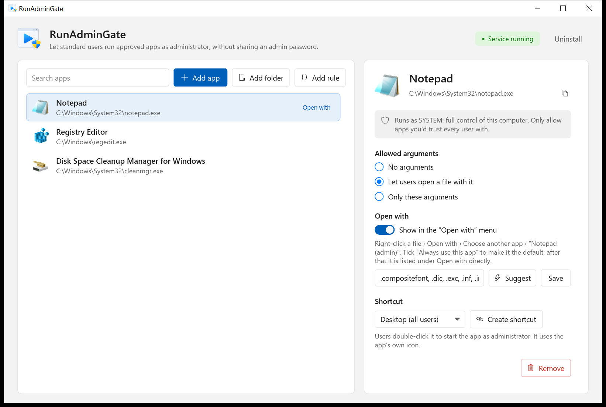
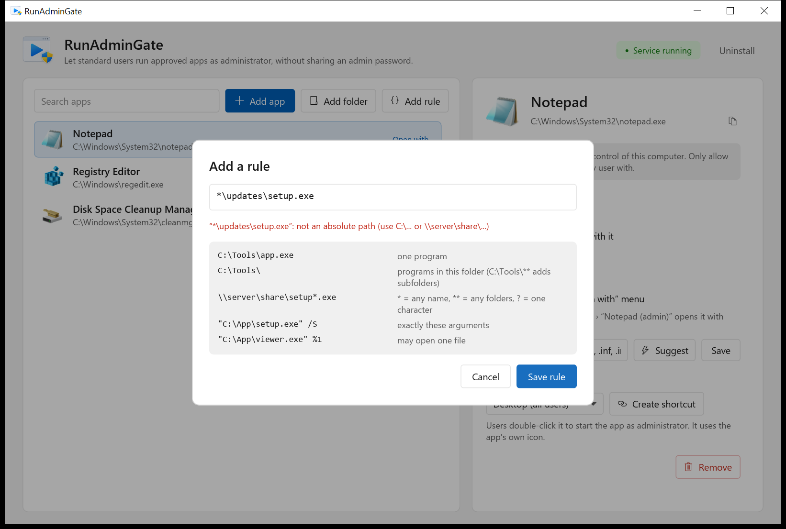
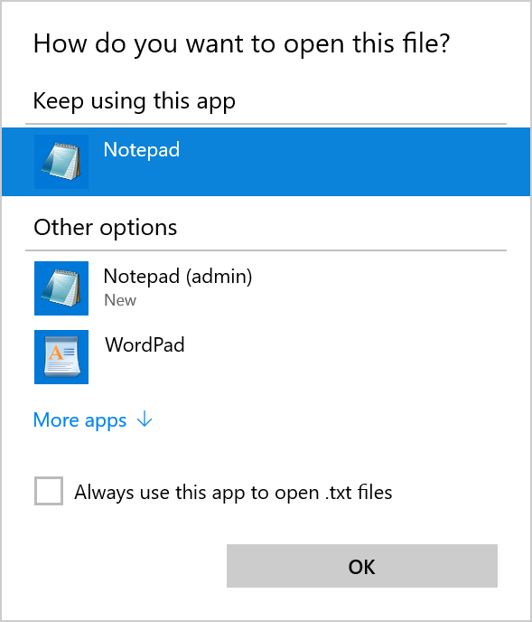

# RunAdminGate

**Run programs as administrator without giving users admin rights.**
RunAdminGate is an open-source, allow-list-based privilege elevation tool for Windows, written in Rust.

Website and setup guide: https://unkatreus.github.io/run-admin-gate/ · Download: [latest release](https://github.com/UnkAtreus/run-admin-gate/releases/latest)

An administrator picks which programs, folders or installers are allowed. A
standard user can then start exactly those programs with administrator or
SYSTEM rights. The user never learns an admin password and never becomes a
permanent local administrator.

> **Status: early development.** SYSTEM mode works and was tested on
> Windows Server 2019 (build 17763). The administrator mode
> (`/asadmin`) isn't implemented yet. Don't deploy it in production.



## Features

- **Allow-list:** allow single apps, whole folders (optionally including subfolders), or patterns such as `\\server\installers\setup*.msi`.
- **"Open with":** opens a file in an elevated app. Windows first lists a new handler under Open with › Choose another app as "Notepad (admin)". After it has been picked once, it appears in the Open with menu directly.
- **Shortcuts:** desktop and Start-menu shortcuts use the app's own icon.
- **Arguments:** per app, allow none, exactly one file (`%1`), or one exact pattern.
- **Audit:** every request, whether allowed or refused, is written to the Windows Event Log with the requesting user.

| Rules are checked before they are saved | "Open with" entry with the app's icon |
|---|---|
|  |  |

## Problems it solves

- Allow a standard user to run a specific program as administrator.
- Run a program as admin without typing the admin password, and without saving the password anywhere.
- Let users install approved software and updates from a share without local admin rights.
- Skip the UAC prompt for one approved program only, not for the whole machine.
- Start a program as SYSTEM from a standard account (device manager, drivers, patches).
- Manage the allow-list centrally with Group Policy across a domain.

## How it works

| Part | What it does | Status |
|---|---|---|
| `runadmingate-manager.exe` | Manager: allow-list, Open with, shortcuts, service install | done, tested |
| `runadmingate.exe` | Service and launcher. Checks the allow-list and starts the program as SYSTEM (admin mode planned) | SYSTEM mode and Open with tested |
| `runadmingate-svc` | Runs a program as a service at boot | planned |
| `runadmingate-elevate` | Requests UAC elevation for programs that don't ask for it | planned |

The allow-list lives in `HKLM\SOFTWARE\RunAdminGate`. Only administrators can
write there, so users can't add entries themselves.

- **`AllowedPath`**: `;`-separated entries. An entry is a program (`C:\Tools\app.exe`), a folder ending in `\`, a wildcard (`\\server\updates\setup*.exe`), or a `%windir%`-style path. Each entry can carry `/assystem` or `/asadmin`.
- **`LogonFlag`**: the default mode, `asservice` (SYSTEM) or `asadmin` (the user's own account, temporarily in local Administrators).

## Build

```sh
cargo test                                # allow-list model tests (any OS)
rustup target add x86_64-pc-windows-gnu   # once; needs mingw-w64 (brew install mingw-w64)
cargo win                                 # -> target/x86_64-pc-windows-gnu/release/{runadmingate,runadmingate-manager}.exe
```

Put `runadmingate-manager.exe` next to `runadmingate.exe`. The **Install service**
button runs `runadmingate.exe /install`.

## Repository layout

- `crates/runadmingate-core`: allow-list model, policy matcher, command builder and pipe protocol (platform-independent, unit-tested).
- `crates/runadmingate-win`: Windows integration shared by both binaries (registry, Open with, icons, shortcuts).
- `crates/runadmingate`: service, installer and client (`runadmingate.exe`).
- `crates/runadmingate-manager`: the manager GUI (`runadmingate-manager.exe`).

## Why RunAdminGate

Most "run as administrator" helpers store an admin password, encrypted or not,
and hand it to a program. RunAdminGate never stores or needs one: a service
checks each request against the allow-list and starts the program itself.

## License

Not chosen yet. `Cargo.toml` says MIT as a placeholder, and there is no LICENSE file.
